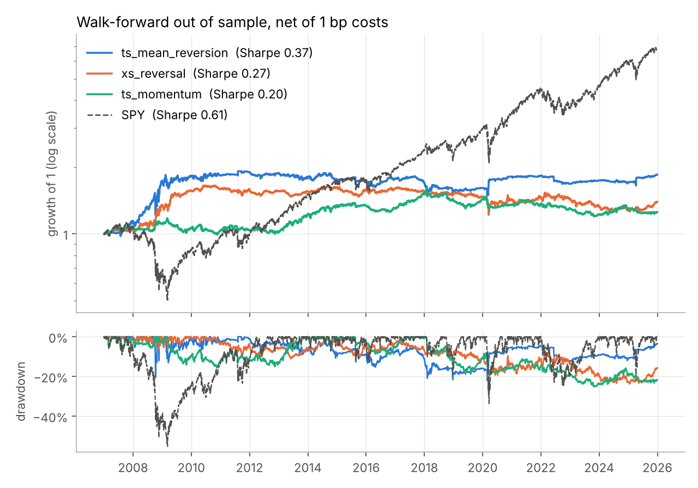
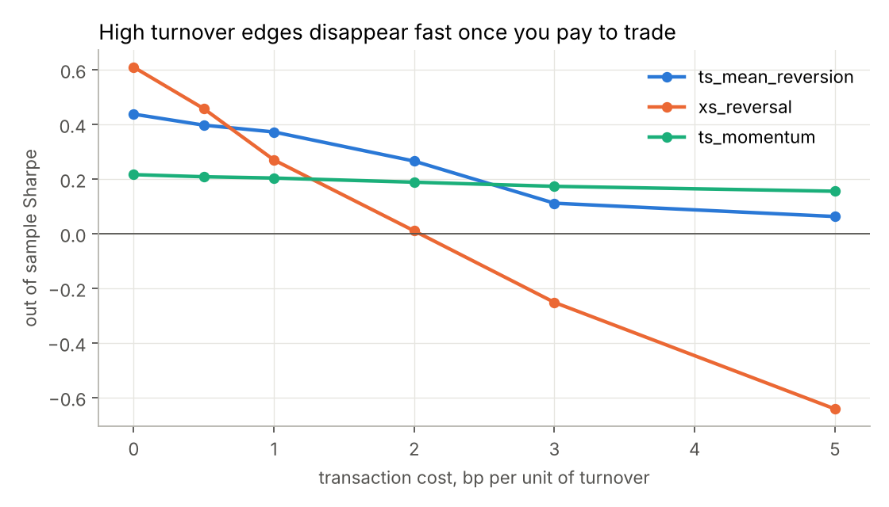
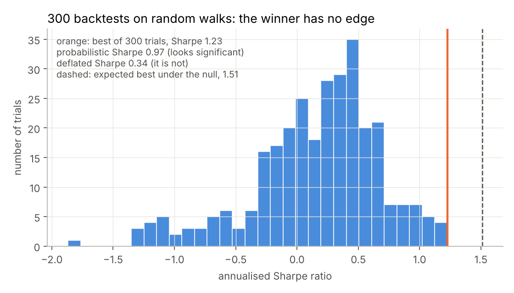

# btlab: walk-forward backtesting that tries hard not to fool itself

[](https://github.com/adrienliao/backtest/actions/workflows/tests.yml)


Most backtests look great because of three mistakes: using information from the future, ignoring trading costs, and picking the best of many parameter sets after the fact. This project is a small, vectorised backtester built around avoiding those three, tested on 22 years of daily data for the nine SPDR sector ETFs.

## What is inside

| Module | Content |
| --- | --- |
| `engine` | Target weights in, net returns out. Weights are lagged one bar and costs are charged on turnover, so a flip from short to long pays twice. |
| `signals` | Time series mean reversion, cross sectional short term reversal (dollar neutral), and time series momentum with volatility targeting and a leverage cap |
| `walkforward` | Rolling 3 year training window, 6 month test window. Best parameters on the training window are frozen and traded on the next one. Weights are stitched across folds so the cost of switching parameters is paid too. |
| `metrics` | Sharpe, Sortino, Calmar, drawdowns, turnover, moving block bootstrap CI, probabilistic Sharpe ratio, deflated Sharpe ratio |

## Results on sector ETFs, 2007 to 2025, out of sample



With 1 bp of cost per unit of turnover:

| Strategy | Walk-forward Sharpe | 95% bootstrap CI | Best in hindsight | Deflated Sharpe of that best | Turnover per year |
| --- | --- | --- | --- | --- | --- |
| Time series mean reversion | 0.37 | [0.04, 0.73] | 0.43 | 0.87 | 52x |
| Cross sectional reversal | 0.27 | [-0.16, 0.69] | 0.21 | 0.67 | 187x |
| Time series momentum | 0.20 | [-0.20, 0.60] | 0.50 | 0.82 | 11x |
| SPY buy and hold | 0.61 | | | | |

What I take from it:

* **None of these beats holding the index on a Sharpe basis.** They do have much smaller drawdowns (22% to 26%, against 55% for SPY in 2008) and daily correlations to SPY between 0.19 and 0.34, which is the only reason one might still care.
* **Hindsight flatters.** Momentum with a 12 month lookback looks like a 0.50 Sharpe strategy if you pick it today, but a researcher choosing parameters with only the data available at the time would have earned 0.20.
* **Costs decide everything for fast signals.** Short term reversal is the best strategy before costs and the worst one at 3 bp. Its break even cost is around 2 bp per unit of turnover, and once spread and slippage are counted that is not a lot of room on sector ETFs.



## Why the deflated Sharpe ratio matters

To check the statistics themselves, I ran 300 randomly parametrised strategies on pure random walks, where by construction nothing can be predicted. The best one shows an annualised Sharpe of 1.23 over three years, and its probabilistic Sharpe ratio (0.97) would call that significant. Once the number of trials is accounted for, the deflated Sharpe ratio drops to 0.34: the result is exactly what you would expect from luck.



## How the code is checked

* **No lookahead, tested.** For every strategy, prices after a cutoff are randomly distorted and the test asserts that every weight before the cutoff is unchanged. The same idea checks that walk-forward selection on a fold never depends on later data.
* The engine applies weights to the next return only, and charges costs exactly on turnover (unit tests on hand computed paths).
* Dollar neutrality and leverage caps are asserted, not assumed.
* PSR increases with track record length, DSR is always below PSR for the best of many trials, and the expected maximum Sharpe grows with the number of trials.

## Run it

```bash
pip install -e ".[dev]"
pytest -q
python -m btlab xs_reversal --cost-bps 1
python scripts/make_figures.py
```

Prices are cached in `data/etf_close.csv` (adjusted closes from Yahoo Finance) so everything runs offline. To refresh them, install the `data` extra and call `btlab.data.download`.

## Limits

Daily close to close fills, a flat cost model with no market impact, no borrow costs on shorts, and a small universe of nine highly correlated ETFs. The walk-forward grid is small on purpose: a bigger grid would mostly buy more overfitting.

## References

* D. Bailey, M. Lopez de Prado (2012), *The Sharpe ratio efficient frontier*
* D. Bailey, M. Lopez de Prado (2014), *The deflated Sharpe ratio: correcting for selection bias, backtest overfitting and non-normality*
* T. Moskowitz, Y. H. Ooi, L. Pedersen (2012), *Time series momentum*
* B. Lehmann (1990), *Fads, martingales and market efficiency*
